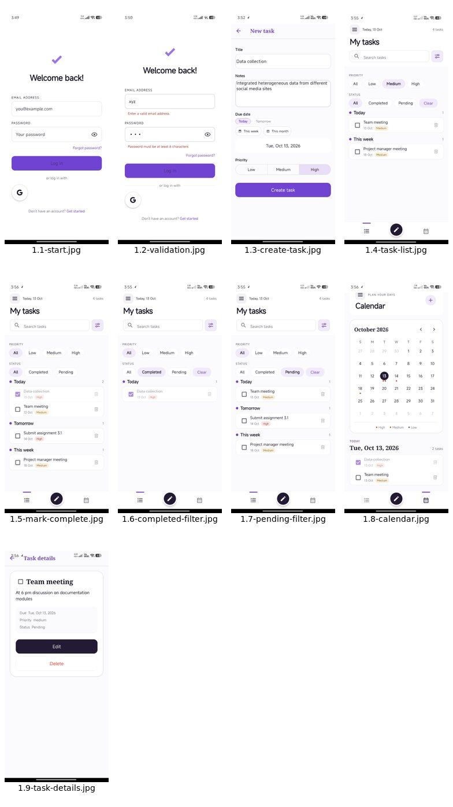
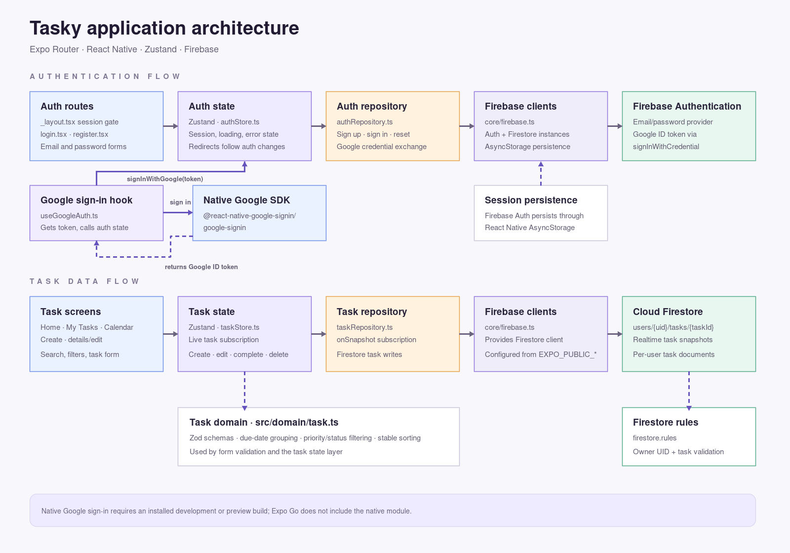

# Tasky

Tasky is a cross-platform task manager built with Expo, React Native, TypeScript,
Firebase Authentication, Cloud Firestore, and Zustand. This README covers the
app workflow shown in the supplied screenshots, project setup, architecture,
security, Android builds, and the APK included in this repository.

## What the app does

- Register and sign in with email/password; reset a forgotten password.
- Sign in with Google using the native Google Sign-In module, then exchange its
  ID token for a Firebase Authentication credential.
- Store tasks in Firestore under the signed-in user's account. Tasks have a
  title, notes, due date, priority, and completion state.
- Search tasks, filter by priority and completion state, and browse tasks in
  date sections or the calendar.
- Create, edit, complete, and delete tasks. The account drawer links to Home,
  My Tasks, Calendar, Settings, and Log out.
- Restore Firebase sessions across app restarts and clear task state when the
  account changes.

The app icon is configured from `assets/app-icon.png`. The source artwork is
kept in `assets/brand/Logo-tasky-source.png`; the logo image is not rendered in
the app screens. The app uses a plain white native splash screen.

## Recorded app workflow

The screenshots below were captured on Android on October 13, 2026. They show a
real app session and sample task data; the app does not seed these tasks
automatically. The flow is numbered in the same order as the provided captures.



| Step | Screen and action | Capture |
| --- | --- | --- |
| 1.1 | Login screen. Enter an email/password or continue with Google. Use **Get started** to open registration. | [1.1 — Login](docs/workflow/images/1.1-start.jpg) |
| 1.2 | Form validation shows errors for an invalid email and a password shorter than six characters; sign-in remains disabled until valid. | [1.2 — Validation](docs/workflow/images/1.2-validation.jpg) |
| 1.3 | Create a task with a title, notes, due date, and priority. The screenshot shows a high-priority task due today. | [1.3 — Create task](docs/workflow/images/1.3-create-task.jpg) |
| 1.4 | The task appears in My Tasks, grouped by due date. Search and priority/status filters are available. | [1.4 — Task list](docs/workflow/images/1.4-task-list.jpg) |
| 1.5 | Mark a task complete with its checkbox; completed tasks use a check mark and strikethrough. | [1.5 — Complete a task](docs/workflow/images/1.5-mark-complete.jpg) |
| 1.6 | Select **Completed** to show only completed tasks. | [1.6 — Completed filter](docs/workflow/images/1.6-completed-filter.jpg) |
| 1.7 | Select **Pending** to show tasks that still need attention. | [1.7 — Pending filter](docs/workflow/images/1.7-pending-filter.jpg) |
| 1.8 | Open Calendar, select a date, and review the tasks due that day. | [1.8 — Calendar](docs/workflow/images/1.8-calendar.jpg) |
| 1.9 | Open a task to review its notes, due date, priority, and status; choose Edit or Delete. | [1.9 — Task details](docs/workflow/images/1.9-task-details.jpg) |
| 2.0 | Open the navigation drawer to switch between Home, My Tasks, Calendar, Settings, or log out. | [2.0 — Navigation drawer](docs/workflow/images/2.0-navigation-drawer.jpg) |

Two extra captures show native Android UI used by the app: [Google account
selection](docs/workflow/images/google-account-picker.jpg) and the [Android date
picker](docs/workflow/images/native-date-picker.jpg).

## Included Android APK

The supplied preview APK is stored at
[`releases/android/Tasky-Android-preview-v1.0.0.apk`](releases/android/Tasky-Android-preview-v1.0.0.apk).
Its metadata was read from the APK manifest and DEX files:

| Property | Value |
| --- | --- |
| Application ID | `com.tasky.app` |
| Version name / code | `1.0.0` / `1` |
| Minimum / target SDK | Android 7.0 (API 24) / API 35 |
| Supported ABIs | `arm64-v8a`, `armeabi-v7a`, `x86`, `x86_64` |
| File size | 76,418,308 bytes (about 72.9 MiB) |
| Original EAS artifact filename | `application-974b1da6-efaf-47d0-9864-49bee2a0f2db.apk` |
| SHA-256 | `662d527bbf3073b6bb02618a82183f0743076b697a5c120f6936566ecca983bb` |

The APK contains the native `RNGoogleSigninModule`. This confirms that the
Google Sign-In library is present in this binary; OAuth still depends on the
Firebase/Google Cloud configuration described below. Expo Go does not contain
the module, so Google sign-in must be run from a development or preview build.
The APK file's workspace timestamp is October 13, 2026 at 16:05 IST; this is a
file timestamp and is not asserted as the EAS build start time.

## Project layout

```text
app/                         Expo Router screens and route gate
  _layout.tsx                Firebase session initialization and route redirects
  index.tsx                  Blank handoff route while auth state restores
  login.tsx, register.tsx    Email/password and Google authentication screens
  home.tsx, settings.tsx     Home overview and account/settings screen
  tasks/                     Task list, calendar, create, and detail/edit routes
src/
  components/                Reusable auth, task, drawer, and navigation UI
  core/                      Firebase setup, errors, dates, Google config, theme
  data/                      Firebase Auth and Firestore repositories
  domain/                    Task types, validation schemas, filtering/sorting
  state/                     Zustand auth/task stores and Google sign-in hook
assets/
  app-icon.png               Launcher icon used by Expo config
  brand/                     Original logo source artwork
docs/architecture/           App architecture diagram, editable SVG, source upload
docs/workflow/               Workflow overview and numbered Android screenshots
releases/android/            Supplied installable Android APK
android/                     Native Android Gradle project and application ID
app.json, app.config.js      Expo app settings and conditional native plugin setup
eas.json                     Development, preview, and production build profiles
firestore.rules              Per-user task access rules
```

Local generated output such as `.expo/`, `dist/`, `android/build/`, and
`node_modules/` is not source and is ignored by Git. It can be regenerated by
the Expo/Gradle/npm commands below.

## Requirements and local setup

- Node.js 20 or later and npm.
- A Firebase project with Authentication and Cloud Firestore enabled.
- For local Android builds: Android Studio/SDK, Java/Gradle prerequisites, and
  a connected device or emulator.
- For EAS builds: an EAS account and the project credentials configured in EAS.

Install dependencies and create local environment configuration:

```bash
npm ci
cp .env.example .env
```

Fill `.env` with the Firebase web-app values. The app reads Expo public
variables at bundle time:

```dotenv
EXPO_PUBLIC_FIREBASE_API_KEY=...
EXPO_PUBLIC_FIREBASE_AUTH_DOMAIN=your-project.firebaseapp.com
EXPO_PUBLIC_FIREBASE_PROJECT_ID=your-project-id
EXPO_PUBLIC_FIREBASE_STORAGE_BUCKET=your-project.appspot.com
EXPO_PUBLIC_FIREBASE_MESSAGING_SENDER_ID=...
EXPO_PUBLIC_FIREBASE_APP_ID=...
EXPO_PUBLIC_FIREBASE_MEASUREMENT_ID=... # optional
EXPO_PUBLIC_GOOGLE_WEB_CLIENT_ID=...    # required only for Google sign-in
EXPO_PUBLIC_GOOGLE_IOS_CLIENT_ID=...    # iOS only
```

Never place service-account private keys in `EXPO_PUBLIC_*` variables. Those
values are embedded in a client app. `.env*` files are ignored except for the
tracked `.env.example` template.

### Firebase and Firestore setup

1. In Firebase Console, enable **Authentication → Sign-in method → Email/
   Password**. Enable **Google** too if Google sign-in is required.
2. Create a Cloud Firestore database.
3. Register a Firebase Web app and copy its config values into `.env`.
4. Publish [`firestore.rules`](firestore.rules) from the Firestore Rules page
   (or deploy it with Firebase CLI).

The rules deny access by default and allow a signed-in user to read and write
only `users/{uid}/tasks/{taskId}` where `{uid}` matches their Firebase UID.
They validate required task fields, timestamps, title length, priority, and
completion state.

### Google sign-in setup

Google sign-in uses `@react-native-google-signin/google-signin` and Firebase's
`signInWithCredential` exchange. Configure all of the following:

1. Enable the Google provider in Firebase Authentication.
2. Set `EXPO_PUBLIC_GOOGLE_WEB_CLIENT_ID` to the OAuth **Web application** client
   ID from the same Firebase/Google Cloud project.
3. In Google Cloud Console, register an **Android OAuth client** for application
   ID `com.tasky.app` and the SHA-1/SHA-256 fingerprints of the signing key used
   for the build. For EAS builds, use the EAS Android keystore fingerprints.
4. Add the web client ID to the EAS **preview** environment as well as local
   `.env`. For iOS, set `EXPO_PUBLIC_GOOGLE_IOS_CLIENT_ID`; `app.config.js`
   derives the required iOS callback URL scheme during prebuild.
5. Build and install a binary that includes the native package. Expo Go cannot
   register `RNGoogleSignin`.

The Android OAuth client ID is configured in Google Cloud for the app package
and signing certificate; the current JavaScript integration passes the Web
client ID to the native SDK to obtain a Firebase-compatible ID token.

## Running and building

Start Metro for Expo Go:

```bash
npm start
```

Expo Go can be used for screens and flows whose dependencies it contains, but
Google sign-in requires the native Tasky build. For a local native Android
build, use `npx expo run:android`. For EAS builds:

```bash
# Install this build on the device, then run Metro with the dev-client scheme.
npx eas-cli build --platform android --profile development
npx expo start --dev-client

# Standalone internal preview APK (does not require Metro to launch).
npx eas-cli build --platform android --profile preview

# Production Android app bundle.
npx eas-cli build --platform android --profile production
```

The `preview` profile uses EAS's `preview` environment and produces an internal
APK. Add the Firebase variables and `EXPO_PUBLIC_GOOGLE_WEB_CLIENT_ID` to that
EAS environment before building. EAS remote credentials are used for Android
signing.

This project contains an `android/` native project. The authoritative Android
application ID is `com.tasky.app` in `android/app/build.gradle`; Expo's
`android.package` config field is intentionally omitted because EAS uses the
native Gradle project. The APK currently targets API 35. EAS versioning uses a
remote source, and the Expo Updates `runtimeVersion` is manually set to
`1.0.0`; update it deliberately when changing the app version/build compatibility.

## Application architecture



The diagram follows the main flows from the screens through Zustand state and
the Firebase repositories to Authentication and Firestore. The supporting
boxes show native Google sign-in, AsyncStorage session persistence, task-domain
validation/filtering, and server-side Firestore rules. The editable vector
source is [tasky-architecture.svg](docs/architecture/tasky-architecture.svg).

The uploaded [`diagram.png`](docs/architecture/tasky-architecture-source.png)
contains the right core components, but its 8,028 × 11,036 layout has many
crossing connectors and small labels that are difficult to read in a README.
It also groups domain validation as task rules without showing the separate
`firestore.rules` security layer. The diagram above is a condensed, code-aligned
version; the original upload is retained for reference.

- **Routes (`app/`)**: Expo Router screens. `_layout.tsx` restores Firebase
  auth state and redirects signed-out users to login and signed-in users away
  from auth routes. The root index is a blank handoff while that state restores.
- **Auth (`src/state/authStore.ts`, `src/data/authRepository.ts`)**: Zustand
  coordinates auth; the repository owns Firebase Auth calls. React Native
  Firebase Auth persistence uses AsyncStorage.
- **Google auth (`src/state/useGoogleAuth.ts`)**: loads the native library only
  when the Google button is pressed, configures it once, checks Android Play
  Services, then exchanges the returned ID token with Firebase.
- **Tasks (`src/state/taskStore.ts`, `src/data/taskRepository.ts`)**: a Firestore
  snapshot subscription feeds the store. Create/edit/toggle/delete writes go
  through the repository; each user's tasks stay under their UID.
- **Validation (`src/domain/task.ts`)**: Zod schemas validate email/password
  and task inputs. Task filtering combines priority and status, then sorts by
  due date, creation time, and ID.
- **Shared UI (`src/components/`)**: reusable auth shell, task card/form,
  filter bar, drawer, and task navigation bar.
- **Firebase config (`src/core/firebase.ts`)**: creates Firebase app, Auth,
  and Firestore singletons. Metro package-exports settings are configured in
  `metro.config.js` for the Firebase React Native auth entry.

## Data model

Tasks are stored at `users/{uid}/tasks/{taskId}` with fields:

| Field | Type | Notes |
| --- | --- | --- |
| `title` | string | Required, 1–200 characters |
| `description` | string | Optional notes; UI validation caps this at 2,000 characters |
| `dueDate` | Firestore timestamp | Used for date grouping and calendar display |
| `priority` | `low` / `medium` / `high` | Required |
| `completed` | boolean | Updated by the task checkbox |
| `createdAt`, `updatedAt` | Firestore timestamps | Written with server timestamps |

Malformed Firestore task documents are skipped rather than crashing the list.
Task subscriptions are cleared when the signed-in account changes.

## NPM scripts

| Command | Purpose |
| --- | --- |
| `npm start` | Start Expo Metro |
| `npm run android` | Start Expo and open Android target |
| `npm run ios` | Start Expo and open iOS target (requires macOS tooling) |
| `npm run web` | Start the web target |
| `npm run typecheck` | Run `tsc --noEmit` |
| `npm run lint` | Run Expo ESLint configuration |

## Troubleshooting

- **`RNGoogleSignin` could not be found**: the app was opened in Expo Go or an
  older binary. Install a new development/preview build containing the native
  module. A Metro reload cannot add native code to an installed app.
- **Google `DEVELOPER_ERROR` / status 10**: check Firebase Google provider,
  web client ID, application ID `com.tasky.app`, and the SHA fingerprint for
  the exact signing keystore used to build the APK.
- **Firebase config missing**: set the Firebase variables locally in `.env`
  and in the selected EAS environment, then rebuild so Expo embeds them.
- **`runtimeVersion` policy rejected by EAS**: this bare Android project uses
  the fixed Expo Updates runtime version in `app.json`; keep it manually in
  sync with app updates as appropriate.
- **EAS package name warning**: `android/app/build.gradle` controls the package
  for the native project. Keep its `applicationId` and `namespace` as
  `com.tasky.app`.

## Verification notes

The APK manifest and DEX were inspected for this README: package/version/SDK
values and supported ABIs are listed above, and the DEX contains
`com.reactnativegooglesignin.RNGoogleSigninModule`. The supplied screenshots
document the UI workflow. These inspections do not claim a live Firebase
account test or a fresh on-device installation test.
